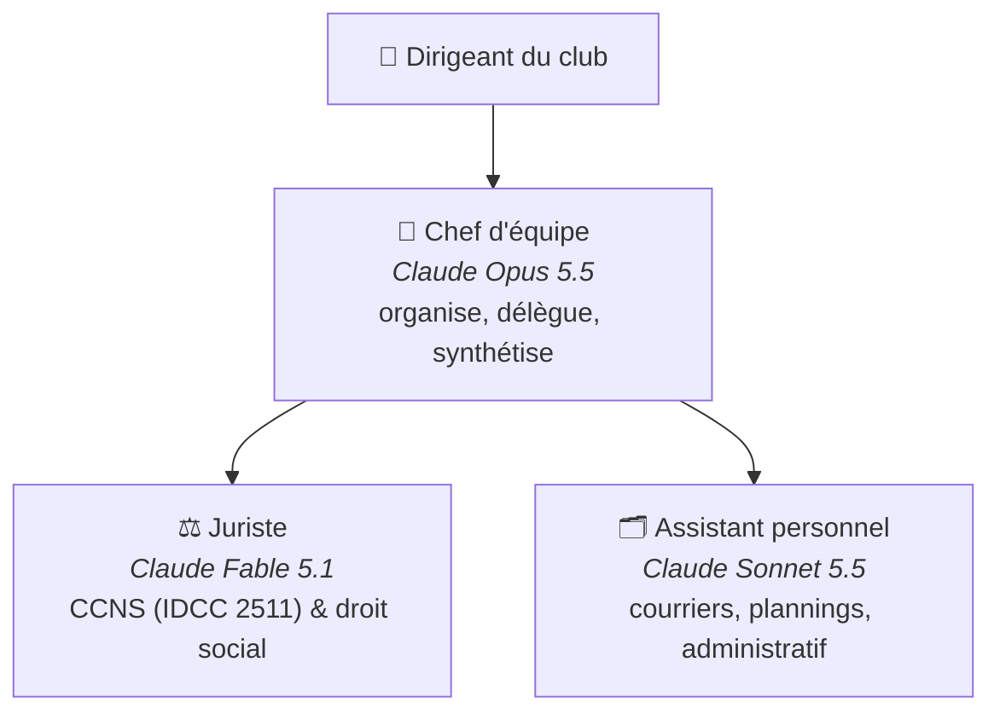

# Club de judo — équipe d'agents IA

Une petite équipe d'agents [Claude Code](https://claude.com/claude-code) pour aider à gérer un club de judo. Conçue pour grandir : on ajoute un agent en déposant un fichier dans `.claude/agents/`.

## Organigramme



## Choix des modèles

| Agent | Modèle | Pourquoi |
|---|---|---|
| **Chef** | Claude Opus 5.5 (`opus`) | Excellent pour comprendre une demande, la découper et piloter d'autres agents, à un coût raisonnable. |
| **Juriste** | Claude Fable 5.1 (`fable`) | Le modèle le plus capable : le droit social ne tolère pas l'approximation (une erreur sur un contrat ou un salaire coûte cher). Le volume de questions d'un club reste faible, donc le surcoût est limité. |
| **Assistant** | Claude Sonnet 5.5 (`sonnet`) | Rapide, très bon rédacteur, économique pour des tâches fréquentes et variées. |

> Pour réduire les coûts, le juriste peut passer sur `opus` (changer `model:` dans `.claude/agents/juriste.md`). Pour des tâches très répétitives, l'assistant peut passer sur `haiku`.

## Utilisation

```bash
claude --agent chef
```

Puis demandez simplement, par exemple :
- « Je veux embaucher un professeur 10 h/semaine en CDI intermittent, qu'est-ce que je dois faire ? »
- « Prépare la convocation à l'AG du 15 novembre. »
- « Un bénévole demande à être défrayé, est-ce possible et comment ? »

Le chef consulte le juriste et/ou l'assistant puis vous rend une synthèse ; les documents produits sont rangés dans `dossiers/`.

**Première étape :** remplissez `club/fiche-club.md` — tous les agents s'en servent.

## Structure

```
.claude/agents/
  chef.md        # orchestrateur
  juriste.md     # CCNS & droit social
  assistant.md   # assistant personnel
club/fiche-club.md   # contexte du club
dossiers/
  juridique/         # avis du juriste
  administratif/     # documents de l'assistant
CLAUDE.md            # règles communes
```

## Ajouter un agent plus tard

1. Créer `.claude/agents/<nom>.md` (en-tête `name`, `description`, `model`, `tools` + instructions).
2. L'ajouter à la ligne `tools: Agent(...)` de `chef.md` et au tableau « Ton équipe ».
3. Mettre à jour l'organigramme ci-dessus.

Idées : trésorier (budget, subventions), responsable communication, responsable sportif (compétitions, grades).

> ⚠️ Les réponses du juriste sont une aide, pas une consultation d'avocat. Pour un contentieux ou une décision lourde, faites valider par un professionnel.
