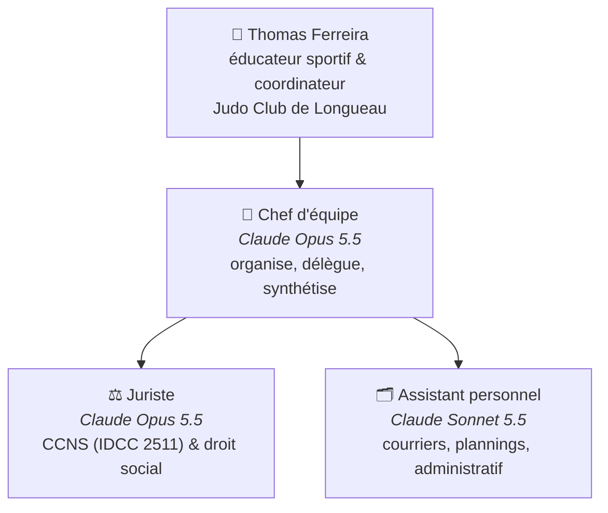

# Club de judo — équipe d'agents IA

Une petite équipe d'agents [Claude Code](https://claude.com/claude-code) pour aider à gérer un club de judo. Conçue pour grandir : on ajoute un agent en déposant un fichier dans `.claude/agents/`.

## Organigramme



## Choix des modèles

| Agent | Modèle | Pourquoi |
|---|---|---|
| **Chef** | Claude Opus 5.5 (`opus`) | Excellent pour comprendre une demande, la découper et piloter d'autres agents, à un coût raisonnable. |
| **Juriste** | Claude Opus 5.5 (`opus`) | Raisonnement juridique rigoureux et vérification des sources, pour un coût bien inférieur à Fable. Pour un dossier très lourd, on peut passer ponctuellement sur `fable`. |
| **Assistant** | Claude Sonnet 5.5 (`sonnet`) | Rapide, très bon rédacteur, économique pour des tâches fréquentes et variées. |

> Le modèle se change dans l'en-tête `model:` de chaque fichier de `.claude/agents/`. Pour des tâches très répétitives, l'assistant peut passer sur `haiku`.

## Utilisation

```bash
claude --agent chef
```

Puis demandez simplement, par exemple :
- « Prépare la convocation à la prochaine réunion de bureau. »
- « Quelles sont les règles de la modulation du temps de travail dans la CCNS ? »
- « Prépare une trame de DUERP pour le club. »

Le chef consulte le juriste et/ou l'assistant puis vous rend une synthèse ; les documents produits sont rangés dans `dossiers/` (ou `prive/` pour ce qui est personnel).

> 🔒 **Confidentialité :** ce dépôt est public. Tout ce qui concerne la situation personnelle (contrat, paie, santé, litige) va dans `prive/`, exclu de git par `.gitignore`.

**Contexte :** `club/fiche-club.md` décrit le club — tous les agents s'en servent.

## Structure

```
.claude/agents/
  chef.md        # orchestrateur
  juriste.md     # CCNS & droit social
  assistant.md   # assistant personnel
club/fiche-club.md   # contexte du club
dossiers/
  juridique/         # avis du juriste
  administratif/     # documents de l'assistant
CLAUDE.md            # règles communes
```

## Ajouter un agent plus tard

1. Créer `.claude/agents/<nom>.md` (en-tête `name`, `description`, `model`, `tools` + instructions).
2. L'ajouter à la ligne `tools: Agent(...)` de `chef.md` et au tableau « Ton équipe ».
3. Mettre à jour l'organigramme ci-dessus.

Idées : trésorier (budget, subventions), responsable communication, responsable sportif (compétitions, grades).

> ⚠️ Les réponses du juriste sont une aide, pas une consultation d'avocat. Pour un contentieux ou une décision lourde, faites valider par un professionnel.
